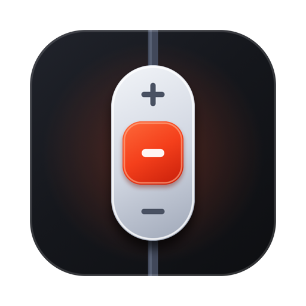

<p align="center">
  
</p>

<h1 align="center">CordKey</h1>

<p align="center">
  <strong>Turn your wired USB / HID headset buttons into Mac keyboard shortcuts.</strong><br/>
  Built for Push-to-Talk voice dictation, voice calls, and hands-free workflows on macOS.
</p>

<p align="center">
  <a href="https://arronkler.github.io/cordkey/"></a>
  
  
  <a href="LICENSE"></a>
</p>

<p align="center">
  <a href="https://arronkler.github.io/cordkey/">Website</a> ·
  <a href="#features">Features</a> ·
  <a href="#quick-start">Quick Start</a> ·
  <a href="#cli-reference">CLI</a> ·
  <a href="#hardware-compatibility">Compatibility</a> ·
  <a href="README.zh-CN.md">简体中文</a>
</p>

---

## Why CordKey?

If you use AI voice dictation ([Wispr Flow](https://www.wisprflow.ai/), Superwhisper, VoiceInk, macOS Dictation) or Push-to-Talk in Discord / Zoom / Lark, reaching for `Right Option`, `Fn`, or `F13` on your keyboard breaks flow the moment you lean back or take notes.

**CordKey** turns the inline buttons on your **USB-C EarPods** or **universal USB/HID headset** (Jabra, Poly, Logitech, HyperX, Sony, USB-C DAC dongles) into real, held macOS keyboard shortcuts — with **zero external dependencies**, exclusive HID seizing that leaves your Mac's built-in media keys untouched, and dedicated engineering for real headset hardware quirks.

### Solving the EarPods Inline Mic Shorting Problem

On Apple EarPods (including the USB-C model), the center inline button shares the same electrical line as the microphone — **holding the center button physically shorts the EarPods mic to ground**, making it go silent while held. CordKey solves this cleanly in two ways:

1. **Clean-Audio Click Toggle**: Tap once and release — CordKey waits **60 ms** after physical release (once the switch clears the mic line, eliminating the initial click noise) before holding down your shortcut, then releases **immediately on the second press** so the ending click is never recorded.
2. **Input Microphone Lock**: Prefer holding the button down? Switch to your Mac's built-in microphone and click the **Lock** icon beside the mic picker — CordKey prevents macOS from silently hijacking default audio input back to `EarPods` whenever you unplug and replug.

---

## Features

| Category | Capabilities |
|---|---|
| **Universal USB/HID Support** | Listens on both **Consumer (`0x0C`)** (Play/Pause, Vol+, Vol−, Audio Mute, Voice Command, Next/Prev) and **Telephony (`0x0B`)** (Mic Mute `0x2F`, Hook Switch `0x20`, Call Hold `0x21`, Redial `0x24`) HID pages. One-click **Learn Button** auto-detects any headset's `VID:PID` and `PAGE:USAGE`. |
| **Native Menu Bar Popover** | Lightweight `LSUIElement` menu bar app with custom vector inline-remote icon, live Signal-Orange hold timer (`0:08`), interactive **Keyboard Shortcut Recorder** (single keys, left/right modifiers like `Right Option` & `Fn`, multi-modifier chords), and bilingual **English / 简体中文** live switching. |
| **3 Trigger Modes + Multi-Action** | **Hold to Hold** (zero latency), **Hold Delay** (`250 / 300 / 500 ms` with independent **Short Tap** and **Double Tap** shortcuts or native media passthrough), and **Click Toggle** (clean-audio 60 ms settle + optional `1m / 2m / 5m` safety auto-release timeout). |
| **Floating Status HUD** | Optional non-activating frosted-glass pill (`Top` / `Bottom`, visible across full-screen Spaces) showing the held shortcut and elapsed duration — click the pill to release immediately without stealing app focus. |
| **Input Mic Lock & Auto-Profiles** | Lock your preferred CoreAudio input device by stable UID against USB hot-plug hijacking; automatically remember & switch button mappings and trigger modes per headset (`VID:PID`) as you plug in different headsets. |
| **App-Aware Rules** | Automatically **Pause** mapping in media players (Music, IINA, QuickTime) or **Override Play** per frontmost app (Lark/飞书, Zoom, Discord, or any running app). |
| **Bluetooth Fallback Mode** | Optional session-level media-key tap (`Click Toggle`) enabling AirPods, Sony, and Bose Bluetooth headsets when no USB headset is connected, with synthetic-event anti-loop tagging. |
| **Stuck-Key & Sleep Safety** | Automatically releases all held keys and passthrough media keys on headset disconnect, system sleep (`willSleepNotification`), mode/config switches, and `SIGINT`/`SIGTERM`. |

---

## Architecture

```text
  USB / USB-C Headset (Consumer 0x0C + Telephony 0x0B)
     │  IOHIDManager (Exclusive Seize — Mac keyboard media keys unaffected)
     ▼
  HIDListener ──► ButtonMapper (+ MultiActionRouter / Clean-Audio Toggle)
     ▲                │
  BluetoothMediaTap   ├──► KeyEmitter (CGEvent + Left/Right NX_DEVICE* masks)
  (Optional AVRCP)    ├──► FloatingHUD + Menu Bar Live Timer + Sound Cues
                      └──► ToggleTimeoutController + Sleep/Disconnect Guards

  Parallel System Watchers:
  • AudioInputManager + MicLockController  (CoreAudio UID lock)
  • HeadsetArrivalWatcher + ProfileStore   (Per-VID:PID auto-switching)
  • FrontmostAppWatcher + AppRules         (Per-app pause / play override)
```

Pure Swift using only Apple system frameworks: `IOKit`, `CoreGraphics`, `CoreAudio`, `AppKit`, `ApplicationServices`, and `SwiftUI`. **Zero third-party packages.**

---

## Quick Start

### Requirements

- **macOS 13.0 (Ventura)** or later
- **Xcode Command Line Tools** (`xcode-select --install`)

### Build & Install Menu Bar App

```bash
git clone https://github.com/arronKler/cordkey.git
cd cordkey
make app-install   # compiles, packages AppIcon.icns, installs /Applications/CordKey.app
open /Applications/CordKey.app
```

### Grant macOS Permissions (One-Time Setup)

1. Click the **CordKey** inline-remote capsule icon in the top-right menu bar.
2. Click **Open Settings** in the Accessibility banner and enable **CordKey** under **System Settings → Privacy & Security → Accessibility**.
3. If macOS prompts for **Input Monitoring** (or the Input Monitoring banner appears), allow **CordKey** under **System Settings → Privacy & Security → Input Monitoring**.

> **Rebuilding from source?** Because local builds use ad-hoc signing (`codesign -s -`), macOS TCC binds Accessibility to the exact binary hash. After rebuilding and reinstalling, if macOS still reports missing permission, remove `CordKey` (`−`) in the Accessibility list and re-add (`+`) `/Applications/CordKey.app`.

---

## CLI Reference

The exact same binary (`bin/cordkey`) doubles as a standalone command-line tool:

```bash
make build

# Inspect connected Consumer / Telephony USB headsets
./bin/cordkey devices

# Live-probe raw PAGE:USAGE codes from ANY plugged-in USB headset
./bin/cordkey probe

# List all supported keyboard key names & aliases
./bin/cordkey keys

# Verify synthetic keyboard & media events received by macOS
./bin/cordkey watch
```

### Mapping Examples

```bash
# Default: EarPods center button -> F13 (hold to hold)
./bin/cordkey

# EarPods clean-audio Click Toggle -> Right Option + subtle sound cues
./bin/cordkey --play right_option --toggle --sound

# Hold >= 300ms -> Right Option; short tap -> Space; double tap -> Escape
./bin/cordkey --play right_option --hold-ms 300 --tap space --double-tap escape

# Office USB headset (e.g. Jabra): Telephony Mic Mute (0x0B:0x2F) -> Right Option
./bin/cordkey --vendor 0x0b0e --product 0x0301 --mic-mute right_option

# Arbitrary HID button (PAGE:USAGE) -> chord
./bin/cordkey --button 0x0b:0x20 cmd+shift+space
```

### Makefile Targets

| Target | Description |
|---|---|
| `make app` | Compile `bin/cordkey`, render `AppIcon.icns`, and bundle `build/CordKey.app` |
| `make app-install` | Build and install `/Applications/CordKey.app` |
| `make app-open` | Build and launch `build/CordKey.app` directly |
| `make build` | Compile the CLI binary `bin/cordkey` |
| `make install` | Install CLI binary to `~/.local/bin/cordkey` |
| `make service-install` | Install & start `io.github.cordkey.cli` LaunchAgent (`ARGS="--play right_option"`) |
| `make service-status` / `service-uninstall` | Inspect or remove the CLI LaunchAgent |

---

## Hardware Compatibility

| Headset Type | Hold-to-Hold | Click Toggle | Exclusive Seize | Notes |
|---|:---:|:---:|:---:|---|
| **Apple USB-C EarPods** (`0x05ac:0x110b`) | ✅\* | ✅ | ✅ | \*Holding center button physically shorts EarPods mic; use **Click Toggle** or **Mic Lock** to MacBook Mic. |
| **USB / USB-C Office & Gaming Headsets** (Jabra, Poly, Logitech, HyperX, Sony USB, etc.) | ✅ | ✅ | ✅ | Supports both `Consumer (0x0C)` and `Telephony (0x0B)` pages; use **Learn Button** or `cordkey probe`. |
| **USB-C to 3.5 mm Audio Adapters** | ✅ | ✅ | ✅ | Works as standard USB HID Consumer device; select via **Learn Button** or **USB Headset** menu. |
| **Bluetooth Headsets** (AirPods, Sony WH/WF, Bose) | — | ✅ | System Tap | Enable **Bluetooth Compatibility Mode** in Advanced; AVRCP sends instant taps (pairs with Click Toggle; also intercepts keyboard F8 Play). |

---

## Privacy & Security

- **100% Local & Offline**: Zero analytics, zero telemetry, zero network requests.
- **No Keyboard Interception**: `HIDListener`, `HIDButtonLearner`, and `HIDProbe` filter strictly to Consumer (`0x0C`) and Telephony (`0x0B`) HID usage pages — keyboard devices (`0x01`/`0x07`) are never matched or seized.
- **Process-Local Key Recording**: The interactive shortcut recorder uses an app-local `NSEvent` monitor (`addLocalMonitorForEvents`) that tears down immediately on capture, `Esc`, or popover dismissal and never logs keystrokes.
- **Safe System Integration**: Atomic plist writes (`PropertyListSerialization` / `plistlib`), single-instance `flock()` lock (`0o600`), and bounds-checked CoreAudio buffer inspection.

---

## License

Released under the [MIT License](LICENSE). Copyright © 2026 [arronkler](https://github.com/arronKler).
